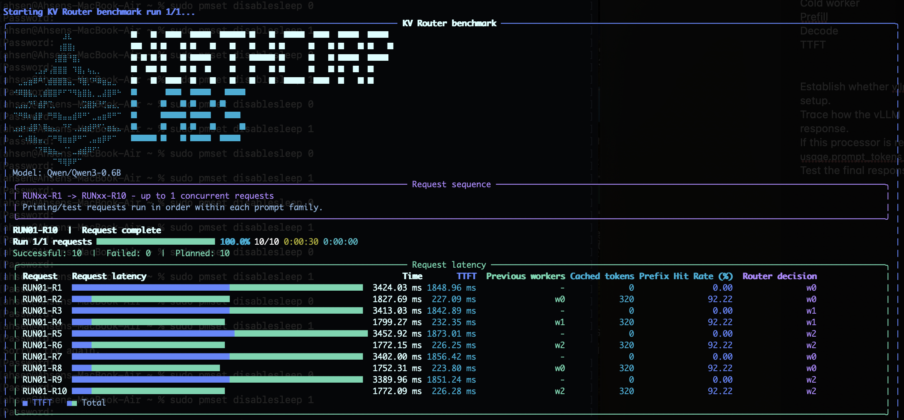
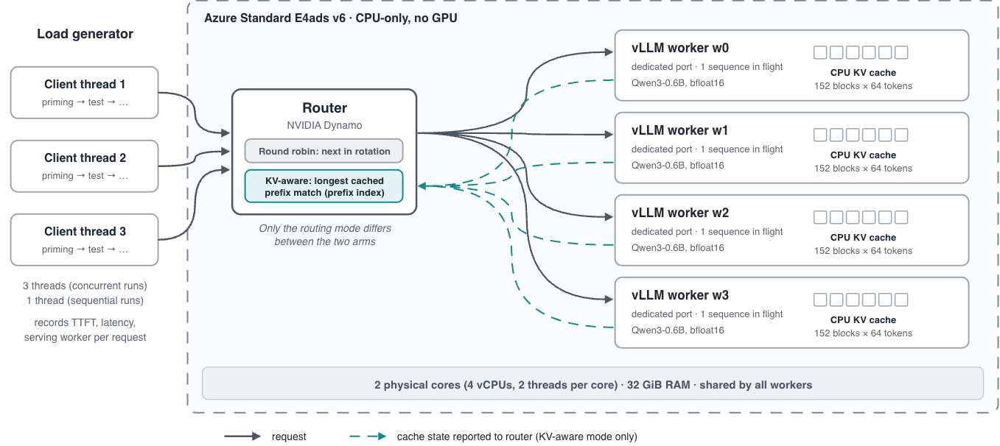

# Dynamo Benchmark: Round Robin vs. KV-Aware Routing





This repository evaluates how Dynamo's round-robin and KV-aware routers affect
prefix-cache reuse and request performance when serving with vLLM-RS. It
compares priming-and-reuse workloads with random prompts, under sequential and
concurrent request patterns.

## Hardware and serving configuration

| Component | Setting |
|---|---|
| Instance | Azure Standard E4ads v6 |
| vCPUs / threads per core | 4 / 2 (2 physical cores) |
| Memory | 32 GiB |
| Accelerator | None (CPU-only inference) |
| Operating system | Ubuntu 24.04 LTS (Canonical server image) |
| Serving engine | vLLM-RS |
| Model | Qwen3-0.6B, bfloat16 |
| Workers | 4, each on a dedicated port |
| KV cache block size | 64 tokens |
| KV cache capacity | 9,728 tokens (152 blocks) per worker |
| Maximum context | 4,096 tokens |

## Results

End-to-end performance is reported as mean ± standard deviation across 10
repeats. Lower TTFT and total latency are better; higher hit rate is better.
Bold indicates the better value in each row. All differences are significant
at *p* < 0.01 (Welch's *t*-test on per-repeat means), except total latency in
configuration 4 (*p* = 0.057).

| Workload | Metric | Round Robin | KV-Aware | Change |
|---|---|---:|---:|---:|
| **1. Priming and reuse, sequential** | TTFT (ms) ↓ | 1810.7 ± 18.0 | **1044.4 ± 14.7** | −42.3% |
|  | Total latency (ms) ↓ | 3401.6 ± 66.7 | **2605.6 ± 45.0** | −23.4% |
|  | Hit rate (%) ↑ | 0.0 ± 0.0 | **46.1 ± 0.0** | +46.1 pp |
| **2. Priming and reuse, concurrent** | TTFT (ms) ↓ | 4652.4 ± 283.3 | **2750.6 ± 42.4** | −40.9% |
|  | Total latency (ms) ↓ | 10240.1 ± 726.7 | **8834.0 ± 198.8** | −13.7% |
|  | Hit rate (%) ↑ | 7.4 ± 7.3 | **46.1 ± 0.0** | +38.7 pp |
| **3. Random prompts, sequential** | TTFT (ms) ↓ | 1059.0 ± 92.0 | **864.7 ± 116.8** | −18.3% |
|  | Total latency (ms) ↓ | 2610.2 ± 86.6 | **2427.6 ± 136.5** | −7.0% |
|  | Hit rate (%) ↑ | 10.7 ± 8.7 | **30.5 ± 10.3** | +19.8 pp |
| **4. Random prompts, concurrent** | TTFT (ms) ↓ | 3010.7 ± 209.5 | **2774.7 ± 96.1** | −7.8% |
|  | Total latency (ms) ↓ | 8855.1 ± 489.2 | 8476.9 ± 312.8 | −4.3% (n.s.) |
|  | Hit rate (%) ↑ | 6.6 ± 8.5 | **18.2 ± 5.2** | +11.6 pp |

## Setup

### Requirements

Use Python 3.12, Docker with the Compose plugin, `uv`, and Cargo
`1.99.1 (5f94df478 2026-08-27)`. Run the commands and launch scripts from the
repository root.

Create and activate a virtual environment:

```bash
uv venv .venv
source .venv/bin/activate
uv pip install rich requests pandas numpy matplotlib seaborn
```

### Build vLLM from source

Build vLLM at **`0.32.1rc1.dev602+g5d35ce393`** (commit `g5d35ce393`). The
benchmark requires the vLLM-RS binary, a CPU backend, and `cached_tokens` in
request tracing.

```bash
cd vllm
git fetch origin g5d35ce393
git checkout g5d35ce393
VLLM_TARGET_DEVICE=cpu uv pip install --editable . --no-build-isolation
./tools/build_rust.sh
cd ..
```

### Build Dynamo from source

Install Dynamo **`v1.6.0`** from its source release in the same environment:

```bash
git clone https://github.com/ai-dynamo/dynamo.git ../dynamo
cd ../dynamo
git checkout v1.6.0
uv pip install --editable .
cd -
```

The launch scripts use `dynamo.frontend` and Dynamo's vLLM sidecar module (or
an installed native sidecar binary).

## Run

Start NATS and etcd **before starting anything else**. From the repository
root, run:

```bash
docker compose -f utils/nats-compose.yml up -d
```

Keep the Compose services running while benchmarking. When finished, stop them
with:

```bash
docker compose -f utils/nats-compose.yml down
```

Use two terminals. In both, activate the environment and stay in the
repository root.

1. In the first terminal, start one four-worker configuration and leave it
   running:

   ```bash
   ./agg_rr_4.sh
   ```

   For KV-aware routing, use this launcher instead:

   ```bash
   ./agg_kv_router_4.sh
   ```

2. In the second terminal, run the matching benchmark:

   ```bash
   python main.py --round-robin
   ```

   or:

   ```bash
   python main.py --kv-router
   ```

Run the other router configuration with its matching launcher and benchmark
option to compare results. Use `python main.py --cache-reuse` for the
cache-reuse experiment, or run `python main.py` to select interactively. The
launch scripts default to `Qwen/Qwen3-0.6B`; set `MODEL` in the launch command
to select another compatible model.

## CPU and CUDA

The checked-in configuration is for CPU-only hardware. To use CUDA, install a
CUDA-enabled vLLM build and edit the selected launch script: change
`export VLLM_TARGET_DEVICE=cpu` to `export VLLM_TARGET_DEVICE=cuda`, then set
the `VLLM_WORKER*_GPU` assignments for the desired devices. CPU and CUDA vLLM
builds are not interchangeable.

## Tests

With the benchmark environment active, run the unit tests from the repository
root:

```bash
python -m unittest test_logic
```
